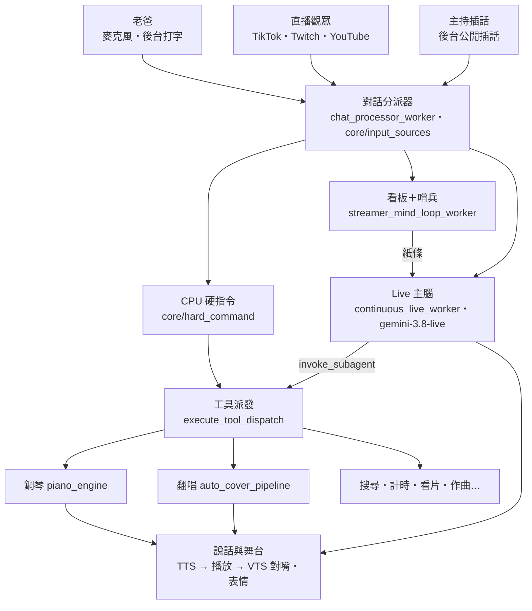

# ARCHITECTURE — 7L 整體架構

> 2026-10-25 整理，10-26 更新。想知道「某件事在哪裡處理」先看這頁；AI 供應商與配額看 [AI_SOURCES.md](AI_SOURCES.md)，開播步驟看 [GETTING_STARTED.md](GETTING_STARTED.md)。

## 1. 一則輸入的旅程

1. **進來**：所有輸入都丟進同一個 `input_queue`，由 `chat_processor_worker` 用 `core/input_sources.classify()` 分流：
   `operator`（老爸）／`audience`（觀眾彈幕）／`owner_interject`（主持插話）／`ambient`（點讚進房）／`unknown`。休眠中誰能叫醒她由 `sleep_wake_decision()` 決定。
2. **CPU 硬指令**（`core/hard_command.parse_hard_command`）：點歌、彈琴、彈加唱、鋼琴停止／暫停／繼續、停止唱歌，純正則、零 API。觀眾不能控制鋼琴和停歌（`STAGE_CONTROL_TOOLS`）。
3. **老爸的話**：Live 模式直通 Live 主腦；Live 沒連上時走 REST 備援大腦 `fetch_ai_response`（多模型梯隊＋金鑰輪替）。
4. **觀眾的話**：寫進看板 `STREAMER_MIND_BOARD`，`judge_subconscious_intent_via_live_api`（哨兵）判斷要不要回，要回就把紙條塞給 Live 主腦。
5. **Live 主腦**只有一個工具 `invoke_subagent`（非阻塞）。
   - 舞台動作（彈、唱、彈加唱、停／暫停／繼續鋼琴、停歌、看片）她直接填 `action`＋`song`／`url`，`structured_stage_command` 轉成工具，交給 `run_stage_commands` 執行。權限、去重、應答都在 `run_stage_commands`，CPU 硬指令也走它。
   - 她自己要彈唱時，`stage_request_unasked` 先對照觸發這輪的那句人話有沒有人點歌：Live 續接的對話會讓她翻出舊點歌。
   - 其他事填 `other`：先試 CPU 硬指令，不中再交 NV／Gemini 解讀（`nv_interpret_task`），最後由 `execute_tool_dispatch` 執行。要看螢幕的交給視覺大腦。
   - 用誰的權限、替誰做事，照 `_BRAIN_INPUT_ORIGIN`（觸發這輪的是老爸還是觀眾、是誰）。
6. **給主腦的資料**：
   - 要她回話的走 `send_brain_slip`，是唯一出口，送出那一刻記下是誰觸發的。
   - 不用她回話的背景資料（YouTube 伴看筆記）走 `add_brain_context`，用 `send_client_content(turn_complete=False)` 放進對話，不觸發回話，也不會打斷她。
7. **出去**：
   - 要說的話依序經過 `speech_queue` → `speech_queue_worker` → `play_voice_complete`。
   - 超過 30 字的回覆由 `split_for_streaming` 在標點切段，第一段合成好就先念。
   - 合成交給 `services/tts_router`（本機 GPT-SoVITS 為主，有快取與品質檢查），再由 pygame 播放。嘴型包絡寫進 `core/stage_state`，由 VTS 對嘴；表情時間軸由神態導演（另一條 Live session）排、`services/stage_actions` 執行。

## 2. 分層

| 層 | 位置 | 負責 | 規則 |
|---|---|---|---|
| 協調者 | `vts_7L_test.py` | 啟動約 30 個背景工作、對話分派、Live 主腦連線、REST 備援大腦、子智能體、工具派發、說話播放 | 只做串接；能獨立的功能搬去 services／core |
| 功能 | `services/` | 鋼琴、翻唱、TTS、VTS、後台、彈幕監聽、搜尋… | 需要主程式的東西用參數或 `bind_host` 明確交進來，不從 `__main__` 撈 |
| 共用底層 | `core/` | 金鑰與模型、記憶、提示詞、工具宣告、硬指令、輸入分類、身分、語言判斷 | 不 import 主程式 |
| 插件 | `mic_live_plugin/`、`realtime_tasks/` | 麥克風語意分析、聲紋、桌面視窗感測；任務狀態與 Firebase 同步 | 同 services |

### core/

| 模組 | 內容 |
|---|---|
| `llm_engine.py` | 模型名稱登記（`LIVE_MODEL`、`FAST_TEXT_MODEL`…，換模型只改這裡）、Gemini 金鑰池分工（觀眾哨兵／麥克風／視覺／Proactive／主腦）、(key, model) 冷卻表、通道與模型熔斷鎖（存 `data/api_locks_cache.json`）、限流回報 `report_gemini_key_error`、Live 單次呼叫 `live_one_shot`、模型梯隊 |
| `memory.py` | 統一記憶（對話＋思考雙軌）、長期記憶、觀眾檔案、看板 |
| `prompts.py` | 系統提示詞、TTS 前的文字清洗 `TextCleanEngine` |
| `tool_schema.py` | 給模型看的工具宣告：`INTERACTIONS_TOOLS`、`GENAI_TOOLS`、`LIVE_API_TOOLS` |
| `hard_command.py` | CPU 硬指令、彈加唱拆解、主腦的結構化舞台動作、翻舊點歌檢查、給主腦的紙條文案 |
| `input_sources.py` | 輸入來源分類、休眠喚醒規則 |
| `groq_router.py` | Groq 文字快線（多金鑰、梯隊降級、OpenAI 格式工具轉換） |
| `identity.py`／`lang.py`／`stage_state.py`／`utils.py` | 擁有者與模式、中日文判斷、播放與嘴型狀態、`log_print`／`log_swallowed`／`spawn`（背景任務留參考、出錯必記） |
| `db.py`／`env_config.py`／`paths.py`／`live_timer_sensor.py`／`subagent_router.py`／`websocket_patch.py` | Firestore REST、後台可改的 .env 白名單與 `load_project_env`（讀金鑰的模組自己先讀 .env）、路徑、計時器、子智能體用腦路由、Live 連線相容補丁 |

### services/

| 領域 | 模組 |
|---|---|
| 鋼琴 | `piano_engine.py`（點曲、意圖判斷、排隊、彈唱同步）；視窗本體是獨立程序 `test_virtual_piano.py`；`midi_editor.py`、`soundfont.py` |
| 翻唱與音樂 | `auto_cover_pipeline.py`（yt-dlp → Roformer 分離 → RVC → 雙軌播放；隊列與彈唱會合）、`roformer_sep.py`、`rvc_pitch.py`、`neural_voice_converter.py`、`audio_to_score.py`（扒譜、伴奏轉鋼琴譜）、`stem_pack.py`、`acestep_music.py` |
| 說話 | `tts_router.py`（引擎鏈、快取、品質檢查）＋根目錄 `local_xiaoyi_service.py`（本機 GPT-SoVITS）、`cosyvoice_server.py`（獨立 venv） |
| 舞台 | `vts_client.py`（VTube Studio 連線、表情、走位）、`stage_actions.py`（表情時間軸、表情守護）、`audio_analysis.py`（嘴型包絡、回音比對） |
| 輸入 | `tiktok_listener.py`、`twitch_listener.py`、`youtube_live_listener.py`、`chat_source.py`、`stt.py` |
| 看與找 | `screen_capture.py`、`web_search.py`（Tavily 多金鑰＋DuckDuckGo＋Groq 摘要）、`video_watch.py`、`yt_companion_service.py`、`desktop_helper.py` |
| 後台與記憶 | `web_dashboard.py`（網頁後台）、`dashboard_bridge.py`（後台 ↔ 主程式）、`rag_store.py`／`rag_memory_service.py`／`embedder.py` |

## 3. 執行時的程序與通訊

| 對象 | 怎麼連 |
|---|---|
| 網頁後台 | 主程式內的 aiohttp，`http://127.0.0.1:7860`（佔用時自動換埠） |
| 鋼琴視窗 `test_virtual_piano.py` | 子程序；主程式 → 視窗走 UDP 39282（play／sync／stop…），視窗 → 主程式走 UDP 39281（每秒心跳＋狀態） |
| VTube Studio | WebSocket，預設 8001，連不上會掃 8001–8010 |
| 本機 GPT-SoVITS | 同程序載入（`local_xiaoyi_service`），生成時暫時把 stdout 導到網頁後台 |
| CosyVoice | 獨立 venv 的本機 HTTP 服務（選配） |
| 雲端 | Gemini（Live＋REST）、NV、Groq、Tavily、Firebase、ElevenLabs（選配）——見 AI_SOURCES |

## 4. 背景工作（`main()` 啟動）

- **輸入**：`text_file_listener_worker`、`console_keyboard_input_worker`、TikTok／Twitch／YouTube 監聽；麥克風走 Live 主腦的原生音訊串流（`mic_worker` 這條舊 STT 路程式碼還在，但 main() 目前沒啟動，見 [REDESIGN.md](REDESIGN.md) H-1）
- **大腦**：`continuous_live_worker`（Live 主腦）、`instinct_live_worker`（身體本能反射）、`chat_processor_worker`、`streamer_mind_loop_worker`、`idle_chatter_worker`
- **說話與舞台**：`speech_queue_worker`、`expression_keeper_worker`、`busy_expression_worker`、`autonomous_wander_worker`、`ai_face_tracking_loop`、`anti_watermark_worker`、`vts_health_worker`
- **感知**：`screen_capture_worker`、`peripheral_vision_worker`、`system_audio_worker`、`mic_volume_worker`
- **鋼琴與翻唱**：鋼琴心跳接收、存活看門狗、啟動時恢復狀態；原創曲資料夾監看
- **其他**：計時器、點播看片、後台、狀態面板、Discord（非 VTuber 模式）、終端狀態列

## 5. 還沒理順的地方

- 主程式還有幾個大函式跟全域狀態綁得很緊：`continuous_live_worker`（約 440 行）、`fetch_ai_response`（約 450 行）、`streamer_mind_loop_worker`（約 300 行）、`process_chat_message`（約 340 行）、`play_voice_complete`（約 290 行）。要拆得先把散在模組層的狀態收成物件。
- `services/piano_engine.py` 將近 3,000 行，點曲意圖、排隊、電台、作曲、合奏都在一起。
- 主程式內部的段落編號（`# 1.`、`# 12.` 那些）跟實際內容已對不上，找東西請用函式名稱搜。

## 6. 整理紀錄

**2026-10-25**：一個修改一個 commit，每個都跑過完整測試與實機。共用模組：`core/lang`、`core/stage_state`、`core/input_sources`、`core/tool_schema`、`services/screen_capture`、`services/stage_actions`、`services/audio_analysis`、`services/web_search`；金鑰冷卻、熔斷鎖、金鑰池、Live 單次呼叫收進 `core/llm_engine`；鋼琴模組改 `bind_host` 明確注入；關鍵路徑的靜默吞錯改 `log_swallowed`；新增彈唱同步（伴奏轉鋼琴譜、共同起點）。主檔 9,787 → 8,822 行。

**2026-10-25～26 第二輪**：同樣一項一個 commit，每項跑完整測試與實機。
- **觸發指令**：主腦直接填結構化舞台動作，不再用正則猜她轉述的說法。她翻舊點歌會被擋下；替誰做事照觸發的人。
- **說話**：長回覆分段播音，第一聲從約 9～11 秒降到 1.3～1.6 秒。含英文的中文句不會再被當日文念。
- **主腦資料**：給主腦的紙條統一走 `send_brain_slip`。伴看筆記改走 `add_brain_context`，老爸用講的問影片也答得出來。
- **穩定性**：背景任務統一走 `spawn()`。外部 AI 呼叫加總時限。鋼琴新場次只有 `_take_stage` 一個入口。VTS 沒開時鋼琴照彈。
- **整理**：模型名稱集中到 `core/llm_engine`。翻唱、看片模組改由 `bind_host` 注入。後台手動工具走同一個派發器。
- 主檔 9,007 行。
