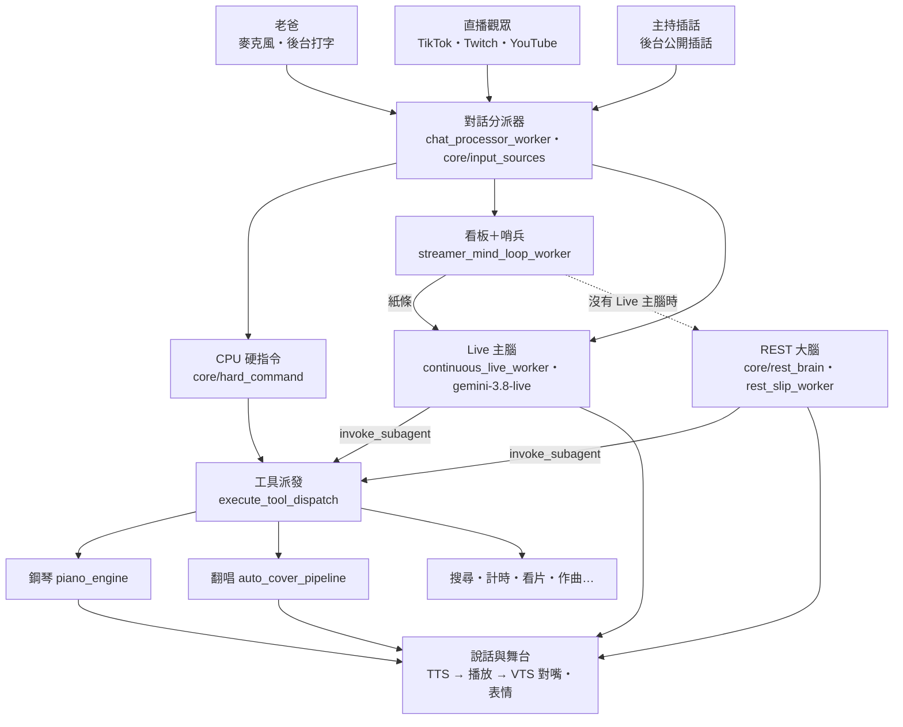

# ARCHITECTURE — 7L 整體架構

> 2026-10-25 整理，10-26 更新（第三輪：REST 大腦、舊 STT 備援；第四輪：REDESIGN A～I 與小項）。想知道「某件事在哪裡處理」先看這頁；AI 供應商與配額看 [AI_SOURCES.md](AI_SOURCES.md)，開播步驟看 [GETTING_STARTED.md](GETTING_STARTED.md)。

## 1. 一則輸入的旅程

另外每件事都記進流水帳（`core/eventlog`，`data/events_<模式>.sqlite`）：輸入、紙條、舞台指令、工具呼叫、她講的話、換狀態。紙條去重、斷線救援、硬指令去重都是查這本帳；`tools/replay.py` 拿它重播一段直播（乾跑，不開 Live、不出聲）。

1. **進來**：所有輸入都丟進同一個 `input_queue`，由 `chat_processor_worker` 用 `core/input_sources.classify()` 分流：
   `operator`（老爸）／`audience`（觀眾彈幕）／`owner_interject`（主持插話）／`ambient`（點讚進房）／`unknown`。休眠中誰能叫醒她由 `sleep_wake_decision()` 決定。
2. **CPU 硬指令**（`core/hard_command.parse_hard_command`）：點歌、彈琴、彈加唱、鋼琴停止／暫停／繼續、停止唱歌，純正則、零 API。觀眾不能控制鋼琴和停歌（`STAGE_CONTROL_TOOLS`）。
3. **老爸的話**：麥克風由 Live 主腦的原生音訊直接聽；打字、`chat_input.txt`、直播間老爸帳號由 `process_chat_message` 寫進記憶、跑 CPU 硬指令、遞紙條（`send_brain_slip`，老爸身分）。
   - Live 主腦斷線超過 `LIVE_FALLBACK_AFTER_SEC`（8 秒）時，麥克風改走舊 STT `mic_worker`（Google 語音辨識＋聲紋＋回音過濾），聽到的話一樣遞紙條；Live 回來就交回。
4. **觀眾的話**：寫進看板 `STREAMER_MIND_BOARD`，`judge_should_speak`（哨兵：Live 單次呼叫優先、Groq 備援）判斷要不要回。要回時：Live 主腦在就把紙條塞給它；不在（`use_rest_brain()`：斷線太久，或 **VTuber 模式本來就不開 Live 主腦**）就用看板專用的提示詞叫 `rest_chat` 直接回。
5. **Live 主腦**只有一個工具 `invoke_subagent`（非阻塞）。
   - 舞台動作（彈、唱、彈加唱、停／暫停／繼續鋼琴、停歌、看片）她直接填 `action`＋`song`／`url`，`structured_stage_command` 轉成工具，交給 `run_stage_commands` 執行。權限、去重、應答都在 `run_stage_commands`，CPU 硬指令也走它。
   - 她自己要彈唱時，`stage_request_unasked` 先對照觸發這輪的那句人話有沒有人點歌：Live 續接的對話會讓她翻出舊點歌。
   - 其他事填 `other`：先試 CPU 硬指令，不中再交 NV／Gemini 解讀（`nv_interpret_task`），最後由 `execute_tool_dispatch` 執行。要看螢幕的交給視覺大腦。
   - 用誰的權限、替誰做事，照 `_BRAIN_INPUT_ORIGIN`（觸發這輪的是老爸還是觀眾、是誰）。
6. **給主腦的資料**：
   - 要她回話的走 `send_brain_slip`，是唯一出口，送出那一刻記下是誰觸發的。紙條有兩個收件人：Live 主腦在線時是 `send_system_prompts_to_live`；沒有 Live 主腦時是 `rest_slip_worker`，交給 REST 大腦（系統提示詞跟 Live 同一份 `build_brain_system_prompt`，另帶最近對話和鋼琴狀態；可以呼叫同一個 `invoke_subagent`，子智能體本體是共用的 `_run_subagent_task`）。
   - 不用她回話的背景資料（YouTube 伴看筆記）走 `add_brain_context`，用 `send_client_content(turn_complete=False)` 放進對話，不觸發回話，也不會打斷她。
   - 看門狗看主腦「有沒有真的產出」：連兩張紙條各 20 秒沒產出（金鑰額度用完時連線還在、但不生成）就關線、冷卻這把、換下一把，那張紙條交給新連線。
7. **出去**：
   - 要說的話依序經過 `speech_queue`（`core/speech_queue`：給老爸的先講、觀眾的最後；被打斷只挑掉 Live 自己排的）→ `speech_queue_worker` → `play_voice_complete`。
   - `split_for_streaming` 在標點切段，第一段合成好就先念；怎麼切照實測的合成／念的速度挑「最快出聲又不停頓」的切法。
   - 合成交給 `services/tts_router`（本機 GPT-SoVITS 為主，有快取與品質檢查），再由 pygame 播放。嘴型包絡寫進 `core/stage_state`，由 VTS 對嘴；表情時間軸由神態導演（另一條 Live session）排、`services/stage_actions` 執行。

## 2. 分層

| 層 | 位置 | 負責 | 規則 |
|---|---|---|---|
| 協調者 | `vts_7L_test.py` | 啟動約 30 個背景工作、對話分派、Live 主腦連線、REST 備援大腦、子智能體、工具派發、說話播放 | 只做串接；能獨立的功能搬去 services／core |
| 功能 | `services/` | 鋼琴、翻唱、TTS、VTS、後台、彈幕監聽、搜尋… | 需要主程式的東西用參數或 `bind_host` 明確交進來，不從 `__main__` 撈 |
| 共用底層 | `core/` | 金鑰與模型、記憶、提示詞、工具宣告、硬指令、輸入分類、身分、語言判斷 | 不 import 主程式 |
| 插件 | `mic_live_plugin/` | 麥克風語意分析、聲紋、桌面視窗感測 | 同 services |

### core/

| 模組 | 內容 |
|---|---|
| `rest_brain.py` | REST 大腦的那一次呼叫 `rest_chat`：純文字先 Groq，不行輪 Gemini (key, model)；可帶工具、聲音、圖片，整段限時。看板 REST 回覆、紙條 REST 大腦、看畫面／照鏡子（`describe_images`）共用 |
| `llm_engine.py` | 模型名稱登記（`LIVE_MODEL`、`FAST_TEXT_MODEL`、`REST_BRAIN_MODELS`…，換模型只改這裡）、Gemini 金鑰池分工（觀眾哨兵／麥克風／視覺／Proactive／主腦）、(key, model) 冷卻表、通道與模型熔斷鎖（存 `data/api_locks_cache.json`）、限流回報 `report_gemini_key_error`、Live 單次呼叫 `live_one_shot`、模型梯隊 |
| `memory.py` | 統一記憶（對話＋思考雙軌，JSON；同時記進流水帳）、長期記憶、觀眾檔案、看板。本機是正本：觀眾檔、知識庫先讀本機，開機不等 Firestore |
| `eventlog.py` | 流水帳（SQLite，只增不改）：查詢、去重用的 `seen`／`last`、每 5 分鐘推一份到 Firestore 備份（畫面描述不上傳） |
| `promptkit.py` | 各角色的提示詞，一個角色一個函式（主腦、子智能體、看板哨兵、畫面哨兵、神態導演、本能腦）；`tests/test_prompt_snapshots.py` 守著 |
| `prompts.py` | TTS 前的文字清洗 `TextCleanEngine`、雲端知識格式化 |
| `usage.py` | 模型用量：每次呼叫記誰叫的、哪個模型、成功沒、限流、時間、token；後台系統監控有表 |
| `settings.py` | 運行模式開機定一次（在 import 記憶模組之前；後台存的模式開關優先），切模式只經 `apply_mode` |
| `speech_queue.py` | 有車道的說話佇列 |
| `barge_in.py` | 她講話時聽老爸插話：聲紋比「像老爸／像她」，連兩次像老爸才停下她、把聲音送給 Live；她的回音不算 |
| `tool_schema.py` | 給模型看的工具宣告：`INTERACTIONS_TOOLS`／`GENAI_TOOLS`（子智能體）、`LIVE_API_TOOLS`／`REST_BRAIN_TOOLS`（主腦唯一的 `invoke_subagent`，Live 版非阻塞）、`resolve_tool_name`（模型回的工具名對回宣告） |
| `hard_command.py` | CPU 硬指令、彈加唱拆解、主腦的結構化舞台動作、翻舊點歌檢查、給主腦的紙條文案 |
| `input_sources.py` | 輸入來源分類、休眠喚醒規則 |
| `groq_router.py` | Groq 文字快線（多金鑰、梯隊降級、OpenAI 格式工具轉換） |
| `identity.py`／`lang.py`／`stage_state.py`／`utils.py` | 擁有者與模式、中日文判斷、舞台狀態（AI 狀態、在講／在唱、還有話在排、`wait_change` 等事件）與嘴型、`log_print`／`log_swallowed`／`spawn`（背景任務留參考、出錯必記） |
| `db.py`／`env_config.py`／`paths.py`／`live_timer_sensor.py`／`subagent_router.py`／`websocket_patch.py` | Firestore REST、後台可改的 .env 白名單與 `load_project_env`（讀金鑰的模組自己先讀 .env）、路徑、計時器、子智能體用腦路由、Live 連線相容補丁 |

### services/

| 領域 | 模組 |
|---|---|
| 鋼琴 | `piano_engine.py`（點曲、意圖判斷、排隊、彈唱同步）；視窗本體是獨立程序 `test_virtual_piano.py`；`midi_editor.py`、`soundfont.py` |
| 翻唱與音樂 | `auto_cover_pipeline.py`（yt-dlp → Roformer 分離 → RVC → 雙軌播放；隊列與彈唱會合）、`roformer_sep.py`、`rvc_pitch.py`、`neural_voice_converter.py`、`audio_to_score.py`（扒譜、伴奏轉鋼琴譜）、`stem_pack.py`、`acestep_music.py` |
| 說話 | `tts_router.py`（引擎鏈、快取、品質檢查）＋根目錄 `local_xiaoyi_service.py`（本機 GPT-SoVITS）、`cosyvoice_server.py`（獨立 venv） |
| 舞台 | `vts_client.py`（VTube Studio 連線、表情、走位）、`stage_actions.py`（表情時間軸、表情守護）、`audio_analysis.py`（嘴型包絡、回音比對） |
| 輸入 | `tiktok_listener.py`、`twitch_listener.py`、`youtube_live_listener.py`、`chat_source.py`、`stt.py` |
| 看與找 | `screen_capture.py`、`web_search.py`（Tavily 多金鑰＋DuckDuckGo＋Groq 摘要）、`video_watch.py`、`yt_companion_service.py`、`desktop_helper.py` |
| 後台與記憶 | `web_dashboard.py`（網頁後台）、`dashboard_bridge.py`（後台 ↔ 主程式）、`rag_store.py`／`rag_memory_service.py`／`embedder.py` |

### workers/

從主檔搬出來的背景工作。經 `host.<名稱>` 讀寫主程式狀態（主程式 import 後 `bind(sys.modules[__name__])`），用到的名稱登記在各模組的 `HOST_ATTRS`，`tests/test_workers_host.py` 核對主程式真的有。

| 模組 | 內容 |
|---|---|
| `face_tracking.py` | 沒有真人追蹤時讓頭、眼睛、身體自己動 |
| `system_audio.py` | 聽電腦在放什麼（音量、人聲、歌名） |
| `vts_health.py` | VTS 斷線重連、重新認證、接回臉部追蹤 |
| `timer_sensor.py` | 計時器到點讓她開口提醒 |
| `mic_volume.py` | 後台、狀態列的麥克風音量表 |
| `cma_panel.py` | 金鑰健康面板（Discord `*vapi`） |

### tools/

| 位置 | 內容 |
|---|---|
| `tools/sim/` | 實機測試：`live_up.sh`（模擬直播包裝開 7L，**開好後確認截圖入口都擋了，沒擋住就關掉**）、`live_down.sh`、`ft.py`（全功能實測各組）、`ex.py`（在跑著的 7L 裡執行一段程式）、`test_all.sh` |
| `tools/replay.py` | 從流水帳挑一段輸入，丟進乾跑包裝（`tests/dryrun.py`）重跑，列出紙條、舞台指令、她要講的話 |

## 3. 執行時的程序與通訊

| 對象 | 怎麼連 |
|---|---|
| 網頁後台 | 主程式內的 aiohttp，`http://127.0.0.1:7860`（佔用時自動換埠） |
| 鋼琴視窗 `test_virtual_piano.py` | 子程序；主程式 → 視窗走 UDP 39282（play／sync／stop…），視窗 → 主程式走 UDP 39281（每秒心跳＋狀態） |
| VTube Studio | WebSocket，預設 8001，連不上會掃 8001–8010 |
| 本機 GPT-SoVITS | 同程序載入（`local_xiaoyi_service`），生成時暫時把 stdout 導到網頁後台 |
| CosyVoice | 獨立 venv 的本機 HTTP 服務（選配） |
| 雲端 | Gemini（Live＋REST）、NV、Groq、Tavily、Firebase（只當備份）、ElevenLabs（選配）——見 AI_SOURCES |

## 4. 背景工作（`main()` 啟動）

- **輸入**：`text_file_listener_worker`、`console_keyboard_input_worker`、TikTok／Twitch／YouTube 監聽；麥克風平常走 Live 主腦的原生音訊串流，Live 斷線超過 8 秒才由 `mic_worker`（舊 STT）收
- **大腦**：`continuous_live_worker`（Live 主腦）、`rest_slip_worker`（沒有 Live 主腦時接紙條）、`instinct_live_worker`（身體本能反射）、`chat_processor_worker`、`streamer_mind_loop_worker`、`idle_chatter_worker`
- Live 主腦兩種模式都開；操作者輸入關閉時（VTuber 模式強制關）不送麥克風，也不啟動本能腦、`mic_worker`、打字監聽（見 REDESIGN P）
- **說話與舞台**：`speech_queue_worker`、`expression_keeper_worker`、`busy_expression_worker`、`autonomous_wander_worker`、`ai_face_tracking_loop`（workers/）、`anti_watermark_worker`、`vts_health_worker`（workers/）
- **感知**：`screen_capture_worker`、`peripheral_vision_worker`、`system_audio_worker`（workers/）、`mic_volume_worker`（workers/）
- **記錄**：流水帳雲端備份（每 5 分鐘）、金鑰健康面板 `cma_monitor_worker`（workers/）
- **鋼琴與翻唱**：鋼琴心跳接收、存活看門狗、啟動時恢復狀態；原創曲資料夾監看
- **其他**：計時器、點播看片、後台、狀態面板、Discord（非 VTuber 模式）、終端狀態列

## 5. 還沒理順的地方

- 主程式還有幾個大函式跟全域狀態綁得很緊：`continuous_live_worker`（約 400 行）、`play_voice_complete`（約 290 行）、`execute_tool_dispatch`（約 220 行）、`streamer_mind_loop_worker`、`chat_processor_worker`（各約 180 行）。後面兩個是乾跑包裝和情境測試直接從主檔抽出來跑的核心流程，要搬到 workers/ 得先讓乾跑支援 `host` 模組（REDESIGN I 的下一步）。
- `services/piano_engine.py` 將近 3,000 行，點曲意圖、排隊、電台、作曲、合奏都在一起。
- 主程式內部的段落編號（`# 1.`、`# 12.` 那些）跟實際內容已對不上，找東西請用函式名稱搜。

## 6. 整理紀錄

**2026-10-25**：一個修改一個 commit，每個都跑過完整測試與實機。共用模組：`core/lang`、`core/stage_state`、`core/input_sources`、`core/tool_schema`、`services/screen_capture`、`services/stage_actions`、`services/audio_analysis`、`services/web_search`；金鑰冷卻、熔斷鎖、金鑰池、Live 單次呼叫收進 `core/llm_engine`；鋼琴模組改 `bind_host` 明確注入；關鍵路徑的靜默吞錯改 `log_swallowed`；新增彈唱同步（伴奏轉鋼琴譜、共同起點）。主檔 9,787 → 8,822 行。

**2026-10-25～26 第二輪**：同樣一項一個 commit，每項跑完整測試與實機。
- **觸發指令**：主腦直接填結構化舞台動作，不再用正則猜她轉述的說法。她翻舊點歌會被擋下；替誰做事照觸發的人。
- **說話**：長回覆分段播音，第一聲從約 9～11 秒降到 1.3～1.6 秒。含英文的中文句不會再被當日文念。
- **主腦資料**：給主腦的紙條統一走 `send_brain_slip`。伴看筆記改走 `add_brain_context`，老爸用講的問影片也答得出來。
- **穩定性**：背景任務統一走 `spawn()`。外部 AI 呼叫加總時限。鋼琴新場次只有 `_take_stage` 一個入口。VTS 沒開時鋼琴照彈。
- **整理**：模型名稱集中到 `core/llm_engine`。翻唱、看片模組改由 `bind_host` 注入。後台手動工具走同一個派發器。
- 主檔 9,007 行。

**2026-10-26 第三輪**（[REDESIGN.md](REDESIGN.md) 的 H）：
- **舊 STT 接回**：Live 主腦斷線超過 8 秒時麥克風改走 `mic_worker`，回來就交回。
- **REST 大腦**：`core/rest_brain.py` 一個呼叫函式，三條 REST 路（看板備援、老爸 REST 路、觀眾 Live 管道）收成一條；紙條在沒有 Live 主腦時由 `rest_slip_worker` 接。發現 VTuber 模式不開 Live 主腦，看板 REST 回覆其實是觀眾回覆的主要路。
- **刪掉**：`fetch_ai_response`（看畫面、照鏡子改走 `describe_images`）、老爸 REST 路、觀眾 Live 管道、`realtime_tasks/`、一串只有舊 REST 路在用的函式。
- **順手修**：`chat_input.txt` 的字照老爸身分給主腦；子智能體回不存在的工具名時對回；TTS「查查」念成「喳喳」、小數點被念成空格。
- 主檔 7,791 行。

**2026-10-26 第四輪**（[REDESIGN.md](REDESIGN.md) 的 A～I 與小項，細節見那份的第 7 節）：
- **舞台**：她講的話不再被挑關鍵字直接執行（`execute_actions` 只留心想、計時、自我插話、記住位置）；輸入結構化（`viewer`／`content`）；AI 狀態只有一份（`core.stage_state`），輪詢改成等事件；說話佇列有車道。
- **主腦**：連著線卻不講話（額度用完）會自己換金鑰；看板哨兵新提示詞、Live 優先 Groq 備援。
- **記錄**：流水帳 SQLite＋重播工具；模型用量表；Firestore 只當備份、本地優先。
- **測試**：乾跑包裝＋情境測試；實機工具收進 `tools/sim/`；**測試不准寫 `data/`**（10/25～26 有個鋼琴測試每跑一次全套就把 7L 的對話記憶蓋掉，已修、已從備份還原）。
- **拆檔**：6 個背景工作搬到 `workers/`；提示詞收進 `core/promptkit`；運行模式收進 `core/settings`。
- 主檔 6,689 行。
- 老爸的決定（REDESIGN 第 8 節）：VTuber 模式也開 Live 主腦；她講話時聽得到老爸插話（聲紋分得出她的回音）；短回覆也切段；點歌只留主腦回覆；畫面變化只讓她知道。主檔 6,699 行。

