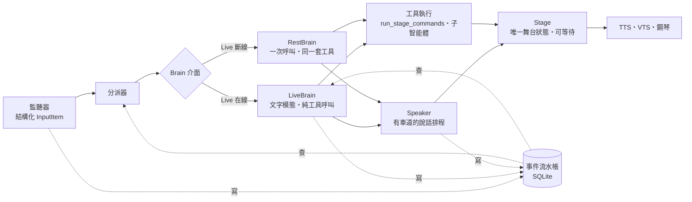

# REDESIGN — 7L 換個想法的地方

> 2026-10-26 看完整體後寫的構想書。**H 已做完**（2026-10-26，見第 7 節），其餘照第 3 節順序進行。前兩輪（見 [ARCHITECTURE.md](ARCHITECTURE.md) 第 6 節）是在原架構裡修；這份列的是「不修了，換個做法」划算的地方。每一項都寫：現在怎麼做 → 問題的根 → 新做法 → 怎麼驗證 → 失敗怎麼退 → 規模。最後有建議順序。照老規矩：一項一個（或幾個）commit，實機測，不行就 revert。

## 0. 體檢數字

先把數字攤開，問題在哪一眼就看得出來（都是今天從原始碼量的）：

| 面向 | 數字 | 代表什麼 |
|---|---|---|
| 主檔 | 9,009 行、161 個頂層函式、**159 個模組級變數、52 個函式寫全域**、108 個函式內 import、317 個 try | 狀態全靠模組命名空間共享；後台 bridge 直接拿 `sys.modules[__name__]` 當物件讀 |
| 協調方式 | 主檔 **60 個 `await asyncio.sleep`**、services 再 24 個；整個專案只有 6 個 `Lock`、2 個 `Event` | 工作之間是「每 0.5～1 秒醒來看旗標」，不是「等到該醒」 |
| 模型協定 | 主檔 77 個正則；`execute_actions` 222 行、`TextCleanEngine` 740 行 | 模型講的話裡夾方括號標籤，系統用正則挑出來執行，再洗乾淨才能念、才能存 |
| Live 連線 | **6 個連線點**：主腦、本能、神態導演、單次哨兵（觀眾／畫面）、YT 伴看、麥克風情緒；單次哨兵每問一次重新握手 | 同一組金鑰、65K TPM 被六條線分；哨兵 3.5 秒 timeout 有一大半花在握手 |
| 主腦模態 | `response_modalities=[AUDIO]`，聲音整段丟掉，只拿 `output_transcription` 再給曉伊念 | 付了「生成聲音＋轉寫」兩道延遲，拿到的是聲音的轉寫，不是模型寫的字 |
| 狀態旗標 | `current_ai_state` 47 處、`pe.is_piano_active` 77 處、`IS_SLEEPING` 32、`CURRENT_SPEAKING_TARGET` 25、`IS_SINGING_ACTIVE` 16 | 「現在能不能開口」在 speech_queue_worker、streamer_mind、臉迴圈各拼一條，拼得都不一樣 |
| 記憶與清單 | 對話／思緒／全景三條 deque、聊天室清單（只剩 1 個讀者）、看板、紙條紀錄、紙條重送、視覺歷史、硬指令去重表… | 同一件事（「剛才發生了什麼」）存了七份，各有各的過期規則 |
| 第一聲延遲 | 主腦轉寫一直累在 `chunk_buffer`，**只在 `turn_complete` 才送 speech_queue**；她講話時麥克風資料被換成全 0 | 模型講三句，她等三句都生成完才開口；她講話中老爸說的話整句消失（見第 6 節 L、M） |
| 測試 | 64 個測試檔、532 通過；**0 個能 import 主檔**、10 個用 `ast` 把函式摳出來 `exec` | 主檔一 import 就拉起 pyaudio／pygame／genai，單元測試只能繞 |
| 實機工具 | `sim_run.py`、`ft.py`、`live_up.sh` 全在 `%TEMP%\vtslint`，不在 repo | 換台機器、清暫存，實機測試方法就沒了 |
| 沒在跑的路 | `mic_worker`（Google STT 整條路，含聲紋、回音比對，約 350 行）**main() 沒啟動**；REST 路約 1,100 行自成一套 | 前者要接回來當 Live 斷線備援（H-1）。後者原以為只在 Live 斷線才走，做 H 時發現 **VTuber 模式根本不開 Live 主腦**，看板的 REST 回覆是觀眾回覆的主要路（見 P） |

## 1. 目標長相



跟現在最大的差別：**模型只講話**（其他全是工具呼叫）、**狀態只有一份**（Stage）、**發生過的事只記一份**（流水帳）、**主檔只剩組裝**。

## 2. 換想法的地方

### A. 模型講的話只剩「話」：方括號標籤 → 工具呼叫

**現在**：提示詞教主腦在句中夾 `[EXPRESSION: 名]`、`[SPEED:+10%]`、`[PITCH:+4Hz]`、`[TOOL:VISION]`、`[TOOL:MIRROR]`、`[TOOL:SEARCH]`、`[INTERRUPT_SELF]`、`[TIMER: 秒|話]`、`[LEARN_MEME]`／`[LEARN_FACT]`／`[UPDATE_RULE]`／`[ADD_EXAMPLE]`、`[THOUGHT: …]`，甚至 `pe.set_piano_speed(1.2)` 這種 Python 呼叫式。`execute_actions` 用 77 個正則挑出來執行，`TextCleanEngine` 再洗乾淨才能念，存記憶前又洗一次（`[SPEED+8%]` 漏冒號也要吃）。她漏冒號、寫錯名、把標籤念出來、TTS 把殘骸唸成亂碼——每一種都要再補一個正則。

**問題的根**：這是用「自然語言裡夾暗號」在做結構化通訊。2026-10-25 把舞台動作改成 `invoke_subagent` 的 `action` 欄位後，「翻譯她的說法」那層直接消失，證明方向對。

**新做法**：Live 工具宣告改成一小組明確的函式，全部 `NON_BLOCKING`：

| 工具 | 取代的標籤 |
|---|---|
| `invoke_subagent(action, song, url, task_instruction)` | 已有 |
| `set_expression(name, at="start"\|"mid"\|"end")` | `[EXPRESSION:]` |
| `look_at_screen()`、`mirror()` | `[TOOL:VISION]`、`[TOOL:MIRROR]` |
| `set_timer(seconds, message)` | `[TIMER:]` |
| `remember(kind, text)` | `LEARN_*`／`UPDATE_*`／`ADD_EXAMPLE` |
| `interrupt_self()` | `[INTERRUPT_SELF]` |

她的轉寫文字 100% 是台詞：清洗引擎只剩破音字、口語正規化、emoji；記憶直接存原文；提示詞刪掉「怎麼寫標籤」那整段（提示詞變短，遵守率通常變好）。`[SPEED]`／`[PITCH]` 直接拿掉——TTS 現在根本不用（`play_voice_complete` 的 chunks 固定 `+0%`／`+0Hz`），只是在燒提示詞和清洗。

**代價**：表情失去「句中位置」。但現在的時間軸是這樣排的：主腦句中有 2 個以上表情標籤才用它的位置，否則問神態導演——實機她幾乎不會寫 2 個，所以位置本來就不是導演在用的資料。`at` 欄位夠用。

**驗證**：實機 20 句老爸對話 + 10 則觀眾留言：工具呼叫率、台詞含殘留標籤的句數（目標 0）、首段延遲不變差。

**退路**：工具宣告和 `execute_actions` 並存一個 commit，日誌確認她改用工具了再刪標籤路；不行就 revert 那個 commit。

**規模**：`core/tool_schema.py` +60、工具派發 +80、`execute_actions` −150、`TextCleanEngine` −200～300、prompts −30 行、記憶清洗 −10。

### B. 主腦改文字模態（2026-10-26 實驗：不可行，見第 7 節）

**現在**：AUDIO 模態，Gemini 的聲音丟掉，只拿轉寫再給曉伊。等於等它「說完一段」才拿到字，字的標點／數字／英文大小寫都是轉寫品質。

**新做法**：`response_modalities=[TEXT]`。文字 token 一出來就能進 `split_for_streaming` 送 TTS，不用等轉寫。

**不確定**：原生音訊 Live 模型可能只支援 AUDIO（2.5 世代如此）；TEXT 模態下 VAD 打斷、`input_transcription`、工具呼叫行為可能不同。所以**先做半天實驗**：用 `%TEMP%\vtslint` 的 live_probe 對 `gemini-3.8-live` 和 `gemini-3.1-flash-live-preview` 各測：連得上嗎、首字延遲、講到一半送新話會不會被打斷、工具呼叫照不照常。

**驗證指標**：turn 開始到 speech_queue 收到第一段的秒數（現在 TTS 端 1.3～1.6 秒，模型端沒量過——實驗第一件事就是量）。

**退路**：一個常數切回 AUDIO。

**跟 A 的關係**：文字模態下「標籤被念出來」的問題自然沒了，但工具化仍是正解；兩個一起做效果最好，B 不成也不影響 A。

### C. 舞台狀態收成一個物件，輪詢改成等事件

**現在**：`current_ai_state`（IDLE／THINKING／TALKING／PIANO／SINGING／SLEEP）一條，旁邊還有 `IS_SINGING_ACTIVE`、`pe.is_piano_active`、`pe.is_piano_performing()`、`stage.IS_MP3_PLAYING`、`pygame.mixer.music.get_busy()`、`CURRENT_SPEAKING_TARGET`、`IS_SLEEPING`、`CURRENT_PLAYING_VOICE_TASK`。每個 worker 自己拼「現在能不能動」：speech_queue_worker 的 `is_vocal_upcoming`、streamer_mind 的 `is_speaking`（4 個條件）、臉迴圈的 `is_playing`（5 個條件）、死掉的 mic_worker 還有一條 5 個條件的。84 個 sleep 輪詢，一半在等某個旗標變。

**新做法**：`core/stage.py` 一個 `Stage`：

```python
class Stage:
    speaking: Utterance | None     # 誰在講、對誰、哪個 turn
    singing:  Song | None
    piano:    Performance | None   # 彈奏中／暫停中／台上待命
    asleep:   bool
    # 只有幾個轉換方法；每次轉換 notify_all() 並廣播到後台
    def quiet(self) -> bool                       # 沒人講、沒人唱
    async def wait_quiet(self, timeout) -> bool   # 取代 while ...: sleep(0.5)
    async def wait_change(self)                   # 任何轉換
    @property
    def ai_state(self) -> str                     # 相容期：由上面推導出舊的六態
```

`set_ai_state`、`is_singing_active`、`pe.is_piano_active` 在相容期都變成 Stage 的 facade，worker 一個一個 commit 換成 `await stage.wait_quiet()`。條件只有一份定義；後台狀態面板直接讀 Stage；測試建一個 Stage 就能跑。

**退路**：facade 期間舊旗標照常可讀，任何 worker 換壞了單獨 revert。

**規模**：新檔 ~150 行；改讀寫點分 6～8 個 commit。

### D. 一本流水帳取代七份清單

**現在**：`UNIFIED_DIALOGUE_MEMORY`、`UNIFIED_THOUGHT_MEMORY`、`UNIFIED_LIVE_MEMORY`、`TIKTOK_CHATROOM_MEMORY`（只剩 `call_gemini_live_audience_reply` 一個讀者）、`STREAMER_MIND_BOARD`（unread／processing／read）、`LIVE_CONTEXT_MEMORY`、`RECENT_SLIPS`、`_LIVE_SLIP_RETRY`、`VISION_HISTORY_STREAM`、`_HARD_CMD_RECENT`、`_PING_LAST_TS`……各有各的上限和過期規則；每 2 秒把整份 JSON 重寫；斷線救援（`_rescue_missed_song_requests`）要翻 `RECENT_SLIPS` 猜哪張紙條沒人認領。

**新做法**：`data/7l_events.sqlite`（WAL）一張表：`ts, kind, who, target, text, meta(json), turn_id`。`kind` ∈ heard／said／slip／tool_call／tool_result／stage／vision／note。所有「發生過的事」只 append 一次。其他全變成查詢：

| 現在 | 變成 |
|---|---|
| 記憶上下文 | 最近 N 筆 kind in (heard, said) |
| 看板未讀 | kind=heard 且沒有同 turn 的 said／tool_call |
| 紙條去重 | 10 秒內同文的 slip |
| 硬指令去重 | 20 秒內同工具同參數的 tool_call |
| 斷線救援 | 有 slip 點歌、沒有對應 tool_call |
| 後台編輯／刪記憶 | UPDATE／DELETE |
| Firestore 同步 | 獨立 worker 把新 rows 推上去 |

**最大收穫不是整潔，是可重播**：把一場直播的 events 丟回分派器（假主腦、假 TTS），離線就能重現 bug。現在每個問題都要開實機、等 Roformer 載完 2～4 分鐘、再用 `/call` 戳。

**風險**：寫入要在單一 writer task 或 `to_thread`；舊 JSON 一次性匯入；`get_unified_memory_context` 的格式要保留給提示詞。

**退路**：先雙寫（JSON 照舊 + SQLite），讀取端一個一個切；全切完才停 JSON。

**規模**：`core/eventlog.py` ~250 行；`memory.py` −300；主檔刪 6 個清單與維護碼。

### E. 輸入從「拼成字串再用正則拆回來」改成結構化

**現在**：監聽器把觀眾留言拼成「【TikTok 直播觀眾 X 留言】：text」丟進佇列；`chat_processor_worker` 用正則拆回 user／content，`process_chat_message` 再拆一次（`tt_match_early`），送禮的名字還要從內文「觀眾「X」」再撈一次；模擬器也得照格式拼。`core/input_sources.InputItem` 已經有 `user`／`platform_uid` 欄位，但 `text` 還是拼好的那串。

**新做法**：監聽器直接產 `InputItem(kind=chat|gift|ambient|operator|interject, platform, user, uid, text, audio, ts)`；「給模型看的那行字」只在塞進 prompt／紙條那一刻由 `render_for_model(item)` 產生。正則全刪，`neutralize_viewer_text` 只在 render 時做一次。

**退路**：`parse_input_item` 相容舊字串一段時間。

**規模**：4 個監聽器各 ~10 行、`chat_processor_worker` −60、`process_chat_message` −40、`sim_run.py` 跟著改。

### F. 說話佇列變成有車道的排程器

**現在**：`speech_queue` 放 dict；「老爸優先」靠 `chat_processor_worker` 把整條佇列倒出來、留下 dad 的再塞回去；`skip_if_singing`、`private`、`priority`（自主漫遊放了 `priority=100`，worker 根本不看）、睡著略過、唱歌空檔插話全在 137 行 worker 裡 if 下去；被打斷時 `receive_from_live` 自己清佇列、再 pop 一筆記憶補救。

**新做法**：`core/speaker.py`：

```python
@dataclass
class Utterance:
    text: str; lane: Literal["dad", "audience", "system"]
    turn_id: str; created: float
    skip_if: Callable[[], bool] | None   # 例：開唱就不講過時的點歌應答
    max_wait: float                      # 觀眾回話排太久就丟

class Speaker:
    async def say(self, u: Utterance)          # 進 PriorityQueue（lane 序 → created）
    def cancel_turn(self, turn_id)             # 打斷＝取消那個 turn 的全部，不清整條
    async def wait_done(self, timeout)
```

規則只寫一處；記憶寫入改在「真的播出」那一刻（現在是主腦 `turn_complete` 就寫，被打斷再 pop）。

**退路**：Speaker 包住現有 `speech_queue.put` 介面相容。

**規模**：新檔 ~200；`speech_queue_worker` −80；`chat_processor_worker` −25；`receive_from_live` −15。

### G. Live 連線：合併、常駐、或改走文字快線

**現在**：6 條。本能腦另開一條 Live、同一份麥克風音訊送兩份，只為輸出 `[EXPRESSION]`／`[MOVE]`；神態導演常駐一條，每句話問一次時間軸；觀眾哨兵和畫面哨兵走 `live_one_shot`，**每問一次新建 WebSocket**，握手 1～3 秒，3.5～3.8 秒 timeout 剩不到一半給生成。

**新做法**：
1. 哨兵改常駐 session（照導演的 ensure／drop 模式），一問只花生成時間；或更徹底——**觀眾哨兵改走 Groq 文字快線**（純文字二元判斷本來就不需要 Live；畫面哨兵要看圖才留 Live）。
2. 本能腦：**已決定（2026-10-26）：留著**。它聽的是環境聲（不只老爸的話）、跟主腦平行、延遲低，主腦的 `set_expression` 取代不了反射。這輪只把它的 `[EXPRESSION]`／`[MOVE]` 正則換成跟 A 同一組工具宣告（本能腦也呼叫 `set_expression`／`move`，一份派發兩邊用），連線本身不動。日後若有更好的做法再提，不在這輪。
3. 導演：A 做完看效果，保留或改成「主腦 `set_expression(at=…)` + TTS 時長推時間軸」。

**驗證**：每條線的重連次數（日誌已有）、哨兵回應延遲中位數。常駐連線數的目標從「6 → 3～4」改成「6 → 5」（哨兵不再每問一次握手；本能腦留）。

**退路**：每條線一個開關常數。

### H. 死路清掉、備援瘦身（2026-10-26 已完成）

這項是「少寫程式」，但最省以後的維護，所以放第一。實際做法和結果見第 7 節。

1. **mic_worker 整條路**（`mic_worker`、`listen_once_fast`、聲紋 verify、`is_7l_voice_echo`、`is_computer_audio_echo`、`GLOBAL_SPEECH_AUDIO_BUFFER` 波形回音比對，約 350 行）程式碼完整還在，但 `spawn(mic_worker(...))` 早在 commit 4a3c539 就被拿掉，main() 還建著 `recognizer` 卻沒人用；麥克風現在只走 Live 原生音訊。**已決定（2026-10-26）：接回來當 Live 斷線時的舊 STT 架構**——`mic_worker` 只在 `is_live_brain_active()` 為假時收音，Live 一回來就停（不然同一句話 Live 聽一次、STT 再送一次）。順手把裡面 5 個條件的「正在講話」判斷換成 Stage（見 C）。ARCHITECTURE.md 第 4 節同步改。
2. **REST 備援**（`fetch_ai_response` 449、`call_gemini_live_audience_reply` 300、`process_chat_message` 後半 ~250、`_build_gemini_contents`、搜尋二階段整合、寫死的點歌罐頭句，約 1,100 行）只在 Live 斷線才走，卻有自己的一套：十幾個工具的 `GENAI_TOOLS`、多通道競速、兩階段搜尋、另一份記憶注入邏輯。新做法：**備援腦只做一件事**——一個 REST 呼叫，產一段話 + 最多一個等價於 `invoke_subagent` 的結構化動作；執行走和 Live 一樣的 `run_stage_commands`／`nv_interpret_task`。一支 ~120 行的 `core/rest_brain.py`，刪 ~900 行。Live 斷線時觀眾由同一支接（哨兵 → 備援腦 → Speaker），`call_gemini_live_audience_reply` 整個不要。
3. 順手：`TIKTOK_CHATROOM_MEMORY`（只剩上面那個讀者）、`GENAI_PROACTIVE_TOOLS`、`execute_tool_dispatch` 裡只有 REST 路會到的分支，一起看。

**退路**：一個 commit 一個 revert。

### P. VTuber 模式也開 Live 主腦（要老爸決定）

**現在**：`continuous_live_worker` 跟麥克風一起放在 `if operator_input_enabled():` 裡，VTuber 模式（`OPERATOR_INPUT` 強制關）**整場沒有 Live 主腦**：
- 觀眾留言靠看板哨兵 → REST 大腦（Groq／Gemini 一次呼叫）回，品質和延遲都跟伴侶模式的 Live 主腦不一樣，兩種模式等於兩個 7L。
- 給主腦的紙條（唱完謝幕、點歌失敗、子智能體結果）以前在 VTuber 模式全部堆在佇列裡沒人收；H 之後改由 REST 大腦接，至少會講了。
- 這不像是刻意的：2026-10-07 把 `mic_worker` 換成 `continuous_live_worker` 時直接放在麥克風原本的位置（「操作者輸入」區塊）。

**新做法**：VTuber 模式也開 Live 主腦，但**不送麥克風**（`send_mic_audio` 在 VTuber 模式一律送靜音，跟現在麥克風開關關掉時一樣），只吃紙條。兩種模式就是同一個主腦、同一套行為；REST 大腦回到真正的備援。

**風險**：VTuber 模式的人設、提示詞是不是要跟伴侶模式分開（現在看板 REST 提示詞是專為直播間調過的，Live 主腦的提示詞偏老爸）；Live 額度多一條常駐線。

**驗證**：VTuber 模式實機：觀眾留言、點歌、謝幕都由 Live 主腦接；Live 斷線時看板照樣走 REST。

### I. 主檔只剩組裝：可 import、可測、可重播

這不是一個 commit，是 C／D／F 做完後自然的收尾，列出來是讓前面幾項往同一個方向拆：

- 每個 worker 搬到 `workers/<名字>.py`，用參數接 `Stage`／`EventLog`／`Speaker`／`Brain`，不碰主檔全域。
- 硬體 import（pyaudio、pygame、speech_recognition、pyautogui）集中到 `hw/`，各自一個 Protocol，測試換假的。
- `tools/sim/`：把 `%TEMP%\vtslint` 的 `sim_run.py`、`ft.py`、`live_up.sh`、`live_down.sh`、`t.sh` 收進 repo。
- `tools/replay.py`：讀 `7l_events.sqlite`，用假腦假嘴把一場直播跑一遍（D 做完才可能）。
- 主檔目標：< 1,500 行，只有 `main()`、組裝、和還沒搬完的東西。

### J. 一個 Brain 介面、三種腦（跟 H 一起做）

`LiveBrain`／`RestBrain`／`DesktopBrain`（桌機代答）統一 `async def turn(input) -> AsyncIterator[Speech | ToolCall]`。分派器只管「有輸入 → 交給 Brain → 結果給 Speaker／工具」，不再知道走哪條、也不再自己判斷 `is_live_brain_active()`。H 瘦身 REST 時順手定義這個介面，Live 那邊相容期用轉接器包。

### K. 重件拆程序（中期、可選）

鋼琴視窗已經是子程序 + UDP，證明模式可行、而且是整個系統最穩的一塊。GPT-SoVITS、Roformer、RVC、embedder 卻都在主程序：任一個載入卡住或崩潰都拖累 Live；實機腳本要等到「Roformer 預載」完才敢算 READY（2～4 分鐘）。`services/cosyvoice_server.py` 已經是獨立 HTTP 服務的樣板——曉伊照抄成 `xiaoyi_server.py`，`tts_router` 多一個 engine 指過去；翻唱管線同理。收穫：主程序秒開、TTS 掛了重啟不斷 Live、GPU 記憶體隔離。代價：音訊 bytes 走 HTTP 多幾毫秒；兩個程序各吃一份 GPU。

### 順手的小項

- **提示詞組裝**：5 份 `prompts/*.md` + `data/7l_persona.json` 的硬規則 + Firestore 雲端知識 + 本能／導演／哨兵／子智能體內嵌字串，分散在五處。抽 `core/promptkit.py`，一個角色一個函式，加快照測試（提示詞改了測試會告訴你）。A 刪標籤段落時一起做。
- **設定**：開機從雲端讀 `MODE_TOGGLE` 後改寫 `os.environ["MODE"]`／`OPERATOR_INPUT`，其他地方再讀環境變數——改成一個 `Settings` 物件，開機組一次。不新增 .env 鍵。
- **Firestore 的角色**：現在是「雲端優先、本地備援」，開機先 `await realtime_task_mgr.sync_to_cloud()`、再 `await get_cloud_knowledge()`，Firestore 慢就開機慢。**已決定（2026-10-26）：純備份**——本地是唯一真相，開機不等雲端；D 的同步 worker 單向把新 rows 和知識庫推上去，推失敗只記日誌。`get_viewer_profile`／`get_cloud_knowledge` 的「Firebase 優先」倒過來改讀本地。
- **`piano_engine.py` 3,036 行**：純搬家，按職責拆 `queue`（點播排程）、`intent`（點曲判斷）、`ipc`（視窗 UDP）、`compose`（作曲）、`band`（合奏）。放最後，等 C／D 的介面定了再搬。

## 3. 建議順序

| # | 項 | 為什麼這個位置 | 做完要看到 | 估 |
|---|---|---|---|---|
| 1 | **H** 舊 STT 接回、備援瘦身（含 N 的 realtime_tasks） | 先減量，後面每項少碰 1,000 行 | 主檔約 8,000 行；532 測試照過；Live 斷線實測：麥克風走舊 STT、備援腦能接老爸和觀眾 | 1～2 天 |
| 2 | ~~**L** 句末就送 TTS~~（量過不成立，改成待決定的「短回覆也切第一段」） | 40 行、整份文件 CP 值最高；先量再改 | 「第一個轉寫 chunk → 第一聲」中位數比現在少掉整段生成的時間 | 半天 |
| 3 | ~~**B** 文字模態實驗~~（兩個 Live 模型都不支援 TEXT） | 半天、只量測不改主線；結果決定 A 怎麼做 | 兩個 Live 模型的首字延遲、打斷行為、工具呼叫是否正常的數字 | 半天 |
| 4 | **A** 標籤 → 工具 | 效果最直接：她不再念標籤、提示詞變短 | 實機 30 句殘留標籤 0；`TextCleanEngine` 砍掉一半 | 2 天 |
| 5 | **E** 結構化輸入 | 小、獨立、立刻少兩層正則 | 分派器裡沒有 `re.search(r'【` | 半天 |
| 6 | **C** Stage | 影響面廣，分 worker 逐個 commit | `asyncio.sleep` 輪詢 84 → < 30；「能不能開口」只剩一處定義 | 2～3 天 |
| 7 | **O** 乾跑＋情境測試 | C 的介面一定，馬上能寫情境；之後每項都靠它驗 | pytest 裡 1 秒跑完「老爸點歌 → 鋼琴收到 → 她應答 → 記憶兩筆」 | 1 天 |
| 8 | **F** Speaker | 依賴 C | 打斷只取消該 turn；老爸優先不再倒佇列 | 1 天 |
| 9 | **G** Live 連線 | 依賴 A 的實測 | 哨兵不再每問一次握手，延遲中位數減半；本能腦改用同一組工具 | 1 天 |
| 10 | **D** 流水帳 | 最大，雙寫過渡 | 七份清單剩一張表；`tools/replay.py` 能離線重現一場直播 | 3～4 天 |
| 11 | **I** 拆 workers、工具進 repo | 收尾 | 主檔 < 1,500 行；`import vts_7L_test` 在測試裡能跑 | 2～3 天 |
| — | **M** 她講話時聽老爸 | 先量（半小時），做法等老爸決定 | 她講長句時老爸插話，Live 收得到 `input_transcription` | 半天～2 天 |
| — | **K**、小項 | 中期、看情況 | | |

每一步都是：commit → `t.sh` 全過 → `live_up.sh` 實機 → 不行 `git revert`。

## 4. 故意不動的

- **CPU 硬指令雙保險**：觀眾零 API、Live 偶爾不呼叫工具（停止彈琴曾 0/3），兩路並行 + 20 秒去重是對的，留著。
- **分段 TTS、金鑰池與冷卻、鋼琴子程序 UDP**：這三塊是現在最穩的，K 反而是要其他重件學鋼琴。
- **彈唱同步、翻唱管線內部**：剛做好、實機過，不在這輪。

## 5. 問過老爸的（2026-10-26 已決定）

| 問題 | 答案 | 寫進哪裡 |
|---|---|---|
| Live 斷線時還要用麥克風嗎？ | 要：舊 STT 路還在，接回來當 Live 斷線時的架構 | H-1 |
| 本能腦要留嗎？ | 盡量留，除非有更好的方法 | G-2 |
| Firestore 多機同步還是純備份？ | 純備份 | 順手小項・D |
| A 要不要等 B 一起上？ | 都可以 → 照順序：B 先量半天，A 再上 | 第 3 節 |
| **（待決定）她講話時老爸插話，要能聽到嗎？怎麼做？** | 見第 6 節 M 的三個選項 | M |
| **（待勾選）第 6 節 N 列的功能，哪些還在用？** | 還用的留、不用的刪、不確定的加日誌看一個月 | N |
| **（待決定）VTuber 模式要不要也開 Live 主腦（不收麥克風）？** | 見 P | P |
| **（待決定）30 字內的短回覆也在第一個逗號切段嗎？** | 第一聲可快約 1.4 秒，但逗號處可能多 0.3～0.5 秒停頓；之前老爸說過怕碎音停頓 | 第 7 節 L |

## 6. 第二遍：換四個角度再看（2026-10-26）

第一遍是從程式結構看的（全域、輪詢、正則、模態、記憶）。第二遍換成：**老爸聽到的延遲**、**壞掉會怎樣**、**閒著在燒什麼**、**哪些功能其實沒在跑**。多出來四項和兩個順手。

### L. 她要等自己「整段講完」才開始合成第一句（2026-10-26 量過：前提不成立，見第 7 節）

**現在**：`receive_from_live` 把轉寫一直累在 `chunk_buffer`，**只在 `turn_complete`／`generation_complete` 才** `execute_actions` → `speech_queue`。所以上一輪「分段 TTS 第一聲 1.3～1.6 秒」是從整段轉寫到齊後才開始算的；模型講三句，她要等三句都生成完才開口。這段時間現在沒量過。

**新做法**：轉寫累到句末標點（。！？～）就切一段先送 `speech_queue`，剩下照舊；記憶還是 turn 結束寫整段；被打斷時取消同 turn 的全部（F 做完更乾淨）。A 做完文字裡沒標籤，切起來最乾淨；A 之前也能做，但要避開標籤被切半（切點只認「標點後面不是 `[`」）。

**先量**：在 `receive_from_live` 記「第一個轉寫 chunk → turn_complete」的秒數，實機 20 句取中位數——這就是能省下的時間。

**退路**：一個常數切回「整段才送」。**規模**：~40 行。

### M. 她講話的時候，聽不到老爸

**現在**：`send_mic_audio` 在 `CURRENT_PLAYING_VOICE_TASK` 跑著時把麥克風資料換成全 0（註解：避免喇叭回音觸發 Live 的 VAD 打斷）。結果不是「不打斷」而是「沒聽到」：老爸在她講話中說的話整句消失，也不能用聲音打斷她。舊 STT 路反而有「全雙工不打斷、背景收老爸輸入」的設計，Live 路沒接過來。

**選項（要老爸決定）**：
1. **耳機開關**：後台一個開關「老爸戴耳機」，開了就不消音（不加 .env）。最簡單，有耳機就能插話；外放時照舊。
2. **本地回音閘**：把舊路的 `check_is_echo_by_waveform`（`GLOBAL_SPEECH_AUDIO_BUFFER` 還在餵）搬到 `send_mic_audio` 前：這 0.5 秒像自己播的聲音 → 送 0；不像 → 放行。便宜，但 0.5 秒 chunk 上準不準要試。
3. **手動 VAD**：她講話中關掉 Live 的自動 VAD，改由本地能量＋回音閘送 `activity_start`／`activity_end`。最穩、最花。

**先量**：實機讓她講一句長的，老爸中途插話，看 Live 有沒有收到 `input_transcription`、她有沒有停。

### N. 只在 Live 斷線才活的子系統，和實測沒碰過的功能

- `realtime_tasks/task_manager.py`（333 行）：`get_realtime_summary()` **只有 REST 路在讀**；每 10 秒把狀態同步到 Firebase。Live 模式下它只在燒 Firestore。→ **已在 H 拿掉**（程式裡沒有任何讀者，Firestore 只當備份）。
- **日誌掃描**：主檔 214 種日誌標籤，78 份實機日誌（22 MB）裡 **123 種從沒出現**。錯誤路徑沒出現是好事；但這些是功能：斷線救援、麥克風控制（「關麥／開麥」關鍵字）、認人、Discord、時事情報中樞、計時器、鏡子、搜網專家、自主甦醒、自主彈琴、電擊／獎勵、哨兵點名應答、Gemini 意圖確認（彈琴中觀眾點歌）、TikTok 降級、老爸幕後指令。**實測沒碰過不等於沒人用**（這些日誌是測試，不是真開台），列出來是請老爸勾：還用的留、不用的刪、不確定的加日誌看一個月再說。

### O. 無硬體乾跑 + 情境測試（從 I 提前）

**現在**：驗一個問題要開實機、等 2～4 分鐘、用 `/call` 戳。

**新做法**：`FakeBrain`（讀腳本：收到什麼就回什麼話、呼叫什麼工具）、`FakeTTS`（回對應長度的靜音 wav）、`FakeVTS`（記下收到的表情／走位）、`FakePiano`（記 UDP 指令）。有了 C 的介面，整條「輸入 → 分派 → 腦 → 說話 → 舞台」在 pytest 裡 1 秒跑完一個情境，例如：「老爸說彈小星星 → 鋼琴收到 play → 她講了一句應答 → 記憶多兩筆」。D 做完再加「拿真直播的 events 當腳本」。這是 I 的核心而不是收尾，所以提前到 C 之後。

### 順手

- **每個模型呼叫點一個計數器**（主腦、哨兵、導演、本能、視覺、子智能體、Groq）：每小時幾次、幾個 token、幾次 429，後台一張表。現在只有 `TOTAL_API_CALLS` 一個總數和 CMA 的金鑰健康；**閒著一小時燒多少，沒人知道**。閒置期固定在跑的：餘光哨兵 5～20 秒一次（每次新建 WebSocket）、系統音辨識、閒聊檢查 30 秒一次、導演每句 ≥ 7 字問一次。
- **紙條分類審計**：哪些 `send_brain_slip` 其實不用她回話（例：`[環境動態]` 畫面變了要不要每次都回？），改走 `add_brain_context`，她就少講廢話、少燒 TTS。

## 7. 進度紀錄

### 2026-10-26：H 完成

一項一個 commit，每項跑完整測試（532 → 554 通過）和實機。主檔 9,009 → 7,791 行，`realtime_tasks/` 整個拿掉，新增 `core/rest_brain.py`（105 行）。

| commit | 做了什麼 | 實機 |
|---|---|---|
| H-1 | 舊 STT（`mic_worker`）接回：Live 主腦斷線超過 8 秒才收音，回來就交回。`chat_input.txt` 打的字改照老爸身分遞紙條（以前被看板當觀眾留言，只有觀眾權限） | 切換正常；麥克風開關在老爸設定裡是關的，沒有實際收音 |
| H-2a | `core/rest_brain.py`：Groq 先、Gemini (key, model) 輪替、整段限時。看板備援改用它；Live 在不在改看「斷線多久」（以前看 `GLOBAL_LIVE_SESSION`，斷線後不會清掉，Live 斷多久都在遞紙條、沒人回） | Live 停掉時觀眾留言由 REST 回 |
| — | 看板 REST 提示詞補「不跳戲」（她說過「我是 AI 沒有嘴巴」） | 同上，改說想吃草莓蛋糕 |
| H-2b | 沒有 Live 主腦時紙條由 `rest_slip_worker` 接，系統提示詞跟 Live 同一份，可以呼叫同一套子智能體。老爸的話一律走紙條；刪掉老爸 REST 路（影子大腦＋串流嘴巴）和觀眾 Live 管道（300 行，沒有路會走到） | Live 真的停掉：打字聊天、謝幕、點歌、收鋼琴都由 REST 接；接回 Live 照常 |
| — | REST 大腦帶工具改 3.6-flash 打頭（實測 3/3 會叫子智能體；3.5-lite 0/3）。子智能體回不存在的工具名（`search_query`）時對回 `search_google` | REST 查天氣講出結果、計時、聊天正常 |
| — | TTS：「查查」不再念成「喳喳」；小數點念「點」（0.21 以前念成「零 二十一」） | GPT-SoVITS 前端確認音素 |
| H-2c | 看畫面、照鏡子改走 `rest_chat`（`describe_images`），刪 `fetch_ai_response`（450 行）和舊 REST 路留下的孤兒 | 照鏡子 4 秒；看畫面同一條路，沒實機看螢幕 |
| H-3 | 拿掉 `realtime_tasks`：沒有讀者，只剩每 10 秒推 Firestore、開機先等它 | 開機、彈琴、觀眾留言、收鋼琴正常 |

**做 H 時看到、還沒處理的**：
- VTuber 模式沒有 Live 主腦 → 新增 P，要老爸決定。
- 主腦把 `[TOOL:MIRROR]` 照完鏡子又說一次，會再照一次（看畫面有防重看，照鏡子沒有）。A 改成工具後一起處理。
- 「老爸」有時被寫成「妳」（模型用字），「開心」偶爾被寫成韓文字「開심」導致表情對不上。
- 點歌時 CPU 罐頭應答＋主腦應答，常講兩次（Live 模式本來就這樣）。

### 2026-10-26：L、B 量測

**B（文字模態）**：兩個 Live 模型（`gemini-3.1-flash-live-preview`、`gemini-3.8-live`）都回 `APIError 1007`：不支援 TEXT 模態。這條路不通，A 照原計畫做。

**L（句末就送 TTS）**：前提不成立。
- 主腦的轉寫在 App 裡是**一整塊**到的：紙條送出後約 0.7～1.2 秒整段文字到齊、緊接著 `generation_complete`（獨立探測器裡會分 6～27 塊、`generation_complete` 在 1.5～3.4 秒，App 的設定不同所以行為不同；不影響結論）。沒有「等她講完」可以省。
- 第一聲慢在**第一段 TTS**：實機 87 句統計，第一段 0～10 字中位數 1.33 秒、16～22 字 1.95 秒、22～30 字 2.72 秒（p90 5.68 秒）。30 字內的回覆現在整句一次合成。
- 要快就得連短回覆也在第一個逗號切開（例：「今天超級充實呀。」先念），第一聲可快約 1.4 秒。代價是第一段和第二段之間可能多 0.3～0.5 秒停頓（每段合成有約 1 秒固定開銷）。程式註解記著老爸以前要求「整段一次合成、怕碎音停頓」，所以**等老爸決定**，不自己改。
